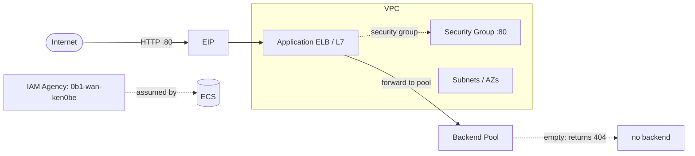

# distributed-x-infrastructure-vpc-alb-foundation

[](LICENSE)
[](https://www.huaweicloud.com/)
[](https://www.terraform.io/)

## 1. Overview

### Introduction

This repository provides a cross-region, multi-environment infrastructure template based on **Terraform + the huaweicloud Provider**: it creates an Internet-facing Layer-7 load balancer (HTTP:80, returning an empty 404 response when no real backend is attached) inside a VPC, together with a security group. It is suitable for teams that need to quickly bring up a "VPC + public application ELB" foundation on Huawei Cloud.

> See `docs/` for the architecture design and adjustment notes.

---

## 2. Table of Contents

- [1. Overview](#1-overview)
- [2. Table of Contents](#2-table-of-contents)
- [3. Architecture Diagram](#3-architecture-diagram)
- [4. Highlights](#4-highlights)
- [5. Cloud Services Used](#5-cloud-services-used)
- [6. Prerequisites](#6-prerequisites)
- [7. Quick Start](#7-quick-start)
- [8. Step-by-Step Deployment](#8-step-by-step-deployment)
- [9. Usage / Verification](#9-usage--verification)
- [10. Cleanup](#10-cleanup)
- [11. Detailed Explanation](#11-detailed-explanation)
- [12. Dependencies](#12-dependencies)
- [13. FAQ / Troubleshooting](#13-faq--troubleshooting)
- [14. Contributing](#14-contributing)
- [15. License](#15-license)
- [16. Contact / Maintainers](#16-contact--maintainers)

---

## 3. Architecture Diagram



---

## 4. Highlights

- **Native Huawei Cloud resources**: VPC / subnets / routes are all declared with native `huaweicloud_*` resources.
- **Multi-environment × multi-region matrix**: `dev/qa/staging/prod × research/risk × regions`, switched through `.tfvars`, one set of code for multiple deployments.
- **Lightweight defaults**: EIP bandwidth `size=5`, the smallest specification for debugging.
- **No credentials in files**: Authentication is provided through the environment variables `HW_ACCESS_KEY` / `HW_SECRET_KEY` / `HW_REGION_NAME`; the code contains no plaintext credentials.

---

## 5. Cloud Services Used

| Cloud Service | Role | Notes |
|---|---|---|
| Virtual Private Cloud (VPC) | Provides an isolated network environment | Single VPC, CIDR `10.0.0.0/16` |
| VPC Subnet | Public / private network layering | 4 by default (2 public + 2 private) |
| Internet Gateway (IGW) | VPC ingress and egress | 1 by default |
| Elastic Load Balance (ELB) | Layer-7 Internet entry point | Default `L7_flavor.elb.s1.small` |
| Elastic IP (EIP) | Provides the public entry point for ELB | Default 5 Mbps |
| Security Group | Inbound :80 allowlist | Access control is handled at the listener layer |
| IAM Agency | Temporary credentials for ECS | Created manually in the console |

---

## 6. Prerequisites

- **Account and permissions**: A Huawei Cloud account with permissions to create VPC / ELB / EIP / IAM resources.
- **CLI tools**:
  - Terraform `>= 1.5`
  - (Optional) Huawei Cloud CLI `hcloud` or `obsutil` (only for OBS backends or verification)
- **Region constraint**: The default region of this template is determined by the variable `region` (default `cn-north-4`). The region codes in `.tfvars` file names are placeholders only, **replace them with real Huawei Cloud region codes**.
- **Credentials**: Provided through environment variables (see below); **do not** write them into any `.tf` file.

```bash
export HW_ACCESS_KEY="<HW_ACCESS_KEY>"
export HW_SECRET_KEY="<HW_SECRET_KEY>"
export HW_REGION_NAME="cn-north-4" # Consistent with the default in variables.tf
# If using temporary credentials:
# export HW_SECURITY_TOKEN="<HW_SECURITY_TOKEN>"
```

---

## 7. Quick Start

Minimal working deployment (single region, single environment, e.g. `dev/research`):

```bash
cd infra
terraform init
terraform plan -var="env=dev" -var="account=555555555555" -var="number_of_azs=2" -out=tfplan
terraform apply tfplan
```

> The multi-environment matrix can be switched via `environments/<env>/<workload>/<region>.tfvars`, but the `.tfvars` files in this repository are placeholders (only `variables.tfvars` contains `account`); fill in the actual values before running or pass them through `-var`.

---

## 8. Step-by-Step Deployment

```bash
# 1) Initialize (download the huaweicloud provider)
terraform init

# 2) Plan (confirm the resource list)
terraform plan -var="env=dev" -var="account=555555555555" -var="number_of_azs=2" -out=tfplan

# 3) Apply
terraform apply tfplan
# Expected: Apply complete! Resources: 11 added ...

# 4) Verify (see docs/deployment-guide.md for details)
curl -i http://<ELB_EIP>:80/
# Expected: HTTP 404 (the empty pool has no backend; the listener has been created and can respond)
```

---

## 9. Usage / Verification

### Usage

After deployment, the load balancer exposes `:80` externally and the listener forwards traffic to an **empty backend pool**; accessing `:80` makes Huawei Cloud ELB return **404** directly, which satisfies the minimal evidence that "the load balancer has been created and can respond".

> Huawei Cloud ELB listeners do not support the fixed-response action (the same effect can be achieved by forwarding to an empty pool through `default_pool_id`), but in practice the empty pool returns 404, so it can be reproduced without any additional backend.

```bash
# Get the public address of the ELB
ELB_IP=$(terraform output -raw elb_public_ip)

# Verify (404 is expected when there is no backend; the listener has been created and can respond)
curl -i http://$ELB_IP:80/
```

The expected response headers/body: `HTTP/1.1 404` + `Server: elb` (no backend available). This is the minimal end-to-end evidence that "the load balancer has been created and can respond".

> After deployment, follow these steps to verify that the business functionality works before considering the delivery complete.

---

## 10. Cleanup

```bash
cd infra
terraform destroy -var="env=dev" -var="account=555555555555" -var="number_of_azs=2"
```

Or call the provided scripts (clean up regional resources first, then global resources, to avoid dependency issues):

```bash
bash infra/scripts/run-tf-regional-destroy.sh
bash infra/scripts/run-tf-global-destroy.sh
```

> After destruction, the related EIP / ELB are released. Make sure they are no longer needed before proceeding.

---

## 11. Detailed Explanation

- **Module structure**:
  - `infra/modules/global`: Terraform code for the IAM Agency (`0b1-wan-ken0be`, trusting the ECS service). **Note**: Due to a limitation of huaweicloud provider v1.96.1, `delegated_service_name` cannot create an agency trusted by ECS through Terraform; create it manually in the console (see "IAM Agency (Manual Creation)" below).
  - `infra/modules/regional`: VPC (calling the `vpc` sub-module) + application ELB (L7 flavor + EIP binding) + security group.
  - `infra/modules/regional/vpc`: native VPC / subnets / routes / EIP.
- **Key configuration items**: see `infra/variables.tf` and `infra/modules/regional/variables.tf`.
- **ELB note**: An enhanced ELB must have an EIP bound to be Internet-facing; the `:80` listener forwards to the backend pool through `default_pool_id` (Huawei Cloud ELB has no fixed-response action), and an empty pool returns 404.
- **IAM Agency (manual creation)**: Due to the field-mapping limitation of huaweicloud provider v1.96.1, `delegated_service_name` cannot create an agency trusted by ECS through Terraform. In the console, go to **IAM > Agencies > Create Agency**: select "**ECS**" as the trusted service, select "**Read-only**" as the permission (or trim it to business needs), and set the name to `0b1-wan-ken0be`. The corresponding Terraform code is kept in `infra/modules/global/` for reference.

---

## 12. Dependencies

- [Terraform](https://www.terraform.io/) `>= 1.5`
- [huaweicloud Provider](https://registry.terraform.io/providers/huaweicloud/huaweicloud/latest) (official Huawei Cloud provider)

---

## 13. FAQ / Troubleshooting

| Symptom | Cause / Resolution |
|---|---|
| `terraform init` fails to download the provider | Check the network/proxy, or pre-cache it offline with `terraform providers mirror` |
| ELB creation reports `ELB.XXXX` / flavor does not exist | Look up `l7_flavor_id` for the actual `region` (console or the `huaweicloud_elb_flavors` data source); names differ across regions |
| ECS assuming the Agency reports insufficient permissions | Check whether the console agency "0b1-wan-ken0be" has been granted the required permissions (e.g. a read-only role), and trim to least privilege (the agency is created manually in the console, see "IAM Agency (Manual Creation)") |
| Accessing `:80` times out | Check whether the EIP is successfully bound to the ELB and whether the security group allows :80; check the EIP status |

---

## 14. Contributing

Issues / PRs are welcome. Before submitting, run `terraform fmt -recursive` and `terraform validate`.

---

## 15. License

MIT No Attribution. See [LICENSE](LICENSE) for details.

---

## 16. Contact / Maintainers
| Item | Content |
|---|---|
| **Creator** | [dgc-git](https://github.com/dgc-git) |
| **Maintainer** | [dgc-git](https://github.com/dgc-git) |
| **Contact** | GitHub Issues / PR (see [Section 14](#14-contributing)) |
