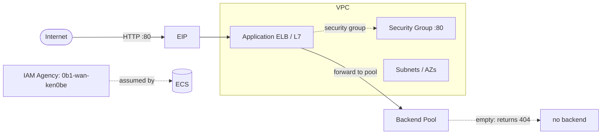

# distributed-x-infrastructure-vpc-alb-foundation · 多环境跨区域基础设施模板（Huawei Cloud）

[](LICENSE)
[](https://www.huaweicloud.com/)
[](https://www.terraform.io/)

## 1. 简介 / Overview

### 简介


本仓库提供一套 **基于 Terraform + huaweicloud Provider** 的跨区域、多环境基础设施模板：在一个 VPC 内创建一个**面向互联网的七层负载均衡器（HTTP:80，未挂载真实后端时返回 404 空响应）**，并配套安全组。适用于需要在华为云上快速拉起「VPC + 公网应用型 ELB」基础底座的团队。

> 架构设计与调整说明见 `docs/`。

---

## 2. 目录

- [1. 简介 / Overview](#1-简介--overview)
- [2. 目录](#2-目录)
- [3. 架构图](#3-架构图)
- [4. 方案亮点](#4-方案亮点)
- [5. 涉及云服务](#5-涉及云服务)
- [6. 前置条件](#6-前置条件)
- [7. 快速开始](#7-快速开始)
- [8. 分步部署](#8-分步部署)
- [9. 使用方法 / 验证](#9-使用方法--验证)
- [10. 清理资源](#10-清理资源)
- [11. 详细说明](#11-详细说明)
- [12. 依赖](#12-依赖)
- [13. FAQ / 故障排除](#13-faq--故障排除)
- [14. 贡献指南](#14-贡献指南)
- [15. 许可证](#15-许可证)
- [16. 联系方式 / 维护者](#16-联系方式--维护者)

---

## 3. 架构图



---

## 4. 方案亮点

- **原生华为云模块**：VPC / 子网 / 路由 全部用 `huaweicloud_*` 原生资源声明。
- **多环境 × 多区域矩阵**：`dev/qa/staging/prod × research/risk × 区域`，通过 `.tfvars` 切换，一套代码多套落地。
- **轻量默认值**：EIP 带宽 `size=5`，调试期最小规格。
- **凭据不写入文件**：认证通过环境变量 `HW_ACCESS_KEY` / `HW_SECRET_KEY` / `HW_REGION_NAME` 提供，代码中不含任何明文凭据。

---

## 5. 涉及云服务

| 云服务 | 作用 | 备注 |
|---|---|---|
| 虚拟私有云 VPC | 提供隔离网络环境 | 单 VPC，CIDR `10.0.0.0/16` |
| 虚拟私有云子网 | 公网 / 私网分层 | 默认 ×4（2 公 + 2 私） |
| 互联网网关 IGW | VPC 出入口 | 默认 1 个 |
| 应用型负载均衡 ELB | L7 互联网入口 | 默认 L7_flavor.elb.s1.small |
| 弹性公网 IP EIP | 为 ELB 提供公网入口 | 默认 5 Mbps |
| 安全组 | 入向 :80 白名单 | 监听器层承担访问控制 |
| IAM 委托（Agency） | ECS 临时凭证 | 控制台手动创建 |

---

## 6. 前置条件

- **账号与权限**：华为云账号，具备 VPC / ELB / EIP / IAM 的创建权限。
- **CLI 工具**：
- Terraform `>= 1.5`
- （可选）华为云 CLI `hcloud` 或 `obsutil`（仅用于 OBS 后端或验证）
- **区域约束**：本模板默认区域由变量 `region` 决定（默认 `cn-north-4`）。`.tfvars` 文件命名中的区域码仅为占位，**实际需替换为华为云区域码**。
- **凭据**：通过环境变量提供（见下），**不要**写入任何 `.tf` 文件。

```bash
export HW_ACCESS_KEY="<HW_ACCESS_KEY>"
export HW_SECRET_KEY="<HW_SECRET_KEY>"
export HW_REGION_NAME="cn-north-4" # 与 variables.tf 默认一致
# 如使用临时凭证：
# export HW_SECURITY_TOKEN="<HW_SECURITY_TOKEN>"
```

---

## 7. 快速开始

最小可用部署（单区域、单环境，如 `dev/research`）：

```bash
cd infra
terraform init
terraform plan -var="env=dev" -var="account=555555555555" -var="number_of_azs=2" -out=tfplan
terraform apply tfplan
```

> 多环境矩阵可通过 `environments/<env>/<workload>/<region>.tfvars` 切换，但本仓库的 `.tfvars` 为占位文件（仅 `variables.tfvars` 含 `account`），实际值请在运行前补全或经 `-var` 传入。

---

## 8. 分步部署

```bash
# 1) 初始化（下载 huaweicloud provider）
terraform init

# 2) 规划（确认资源清单）
terraform plan -var="env=dev" -var="account=555555555555" -var="number_of_azs=2" -out=tfplan

# 3) 应用
terraform apply tfplan
# 预期：Apply complete! Resources: 11 added ...

# 4) 验证（详见 docs/deployment-guide.md）
curl -i http://<ELB_EIP>:80/
# 预期：HTTP 404（空池无后端，监听器已建出且可响应）
```

---

## 9. 使用方法 / 验证

### 使用方法


部署完成后，负载均衡器对外暴露 `:80`，监听器将流量转发到一个**空后端池**；访问 `:80` 华为云 ELB 直接返回 **404**——即「负载均衡器已建出且可响应」的最小证据已满足。

> 华为云 ELB 监听器本身**不支持 fixed-response 动作**（可通过 `default_pool_id` 转发到空池实现相同效果），但实测空池即返回 404，无需额外后端即可复现。

```bash
# 取 ELB 公网地址
ELB_IP=$(terraform output -raw elb_public_ip)

# 验证（无后端时预期返回 404；监听器已建出且可响应）
curl -i http://$ELB_IP:80/
```

预期响应头/体：`HTTP/1.1 404` + `Server: elb`（无可用后端）。这是端到端「负载均衡器已建出且可响应」的最小证据。

> 部署完成后请按本节步骤自行验证，确认业务功能可用，方可视为交付完成。

---

## 10. 清理资源

```bash
cd infra
terraform destroy -var="env=dev" -var="account=555555555555" -var="number_of_azs=2"
```

或调用提供的脚本（先清理 regional 再清理 global，规避依赖）：

```bash
bash infra/scripts/run-tf-regional-destroy.sh
bash infra/scripts/run-tf-global-destroy.sh
```

> ⚠️ 销毁后相关 EIP / ELB 即释放。请确认不再需要再执行。

---

## 11. 详细说明

- **模块划分**：
- `infra/modules/global`：IAM 委托的 Terraform 代码（`0b1-wan-ken0be`，信任 ECS 服务）。**注意**：受 huaweicloud provider v1.96.1 限制，`delegated_service_name` 无法经 terraform 创建 ECS 信任的委托，请在控制台手动创建（见下「IAM Agency 手动创建」）。
- `infra/modules/regional`：VPC（调用 `vpc` 子模块）+ 应用型 ELB（L7 flavor + 绑定 EIP）+ 安全组。
- `infra/modules/regional/vpc`：原生 VPC / 子网 / 路由 / EIP。
- **关键配置项**：见 `infra/variables.tf`、`infra/modules/regional/variables.tf`。
- **ELB 注意**：增强型 ELB 必须绑定 EIP 才对外；监听器 `:80` 通过 `default_pool_id` 转发到后端池（华为云 ELB 无 fixed-response 动作），空池即返回 404。
- **IAM Agency（手动创建）**：受 huaweicloud provider v1.96.1 字段映射限制，`delegated_service_name` 无法经 terraform 创建 ECS 信任的委托。请在控制台 **IAM > 委托 > 创建委托**：被信任服务选「**ECS**」，权限选「**只读**」（或按业务裁剪），名称填 `0b1-wan-ken0be`。对应 Terraform 代码保留在 `infra/modules/global/` 供参考。

---

## 12. 依赖

- [Terraform](https://www.terraform.io/) `>= 1.5`
- [huaweicloud Provider](https://registry.terraform.io/providers/huaweicloud/huaweicloud/latest)（华为云官方）

---

## 13. FAQ / 故障排除

| 现象 | 原因 / 处理 |
|---|---|
| `terraform init` 下载 provider 失败 | 检查网络/代理；或提前 `terraform providers mirror` 离线缓存 |
| ELB 创建报 `ELB.XXXX` / flavor 不存在 | `l7_flavor_id` 按 `region` 实查（控制台或 `huaweicloud_elb_flavors` data 源），不同 region 名称不同 |
| ECS 代入 Agency 报权限不足 | 检查控制台委托「0b1-wan-ken0be」是否已授予所需权限（如只读角色），裁剪为最小权限（该委托在控制台手动创建，见「IAM Agency（手动创建）」） |
| 访问 `:80` 超时 | EIP 是否成功绑定到 ELB、安全组是否放行 :80；检查 EIP 状态 |

---

## 14. 贡献指南

欢迎提 Issue / PR。提交前请运行 `terraform fmt -recursive` 与 `terraform validate`。

---

## 15. 许可证

MIT No Attribution。详见 [LICENSE](LICENSE)。

---

## 16. 联系方式 / 维护者
| 项 | 内容 |
|---|---|
| **创建者** | [dgc-git](https://github.com/dgc-git) |
| **维护者** | [dgc-git](https://github.com/dgc-git) |
| **联系方式** | GitHub Issues / PR（见[第 14 节](#14-贡献指南)） |
