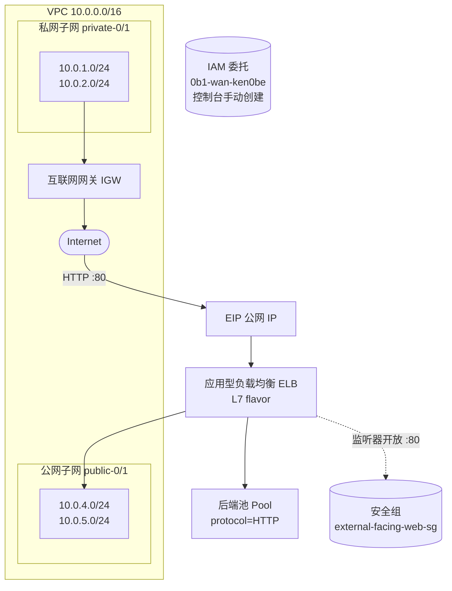

# 华为云 Infrastructure 资源实践（架构说明）

> 基于 Terraform + huaweicloud Provider 的基线基础设施最佳实践，提供一套可直接在华为云落地的「VPC + 应用型负载均衡 + IAM 委托」资源。

## 1. 概述

本实践交付一套基线基础设施：

- **区域级（Regional）**：一个 VPC（10.0.0.0/16），内含公网子网与私网子网；并暴露一个**互联网应用型负载均衡（ELB，L7）**，监听 HTTP :80（本模板默认不启用公网 NAT 网关）。
- **全局级（Global）**：一个 **IAM 委托（Agency）**，信任 ECS 服务，供计算实例在运行时获取临时凭证调用其他云服务。

适用场景：需要在华为云快速拉起一个对外暴露 HTTP 服务入口、并具备标准网络分层（公网/私网）的基线环境（默认不启用 NAT 出网）。

## 2. 架构图

## 3. 资源清单

| 类别 | 华为云服务 | 资源（Terraform） |
|------|-----------|-------------------|
| 网络 | 虚拟私有云 | `huaweicloud_vpc` |
| 网络 | 子网 | `huaweicloud_vpc_subnet` ×4 |
| 网络 | 互联网网关 | `huaweicloud_vpc_internet_gateway` |
| 计算/入口 | 应用型负载均衡 | `huaweicloud_elb_loadbalancer`（L7）+ `huaweicloud_elb_pool` + `huaweicloud_elb_listener` |
| 安全 | 安全组 | `huaweicloud_networking_secgroup` + `huaweicloud_networking_secgroup_rule` |
| 权限 | IAM 委托 | `huaweicloud_iam_agency` |

## 4. 关键设计说明

1. **VPC 模块本地化**：本实践基于 `huaweicloud Provider` 资源自行实现 `modules/regional/vpc`（提供 VPC / 公私有子网 / 互联网网关 / NAT 可选），不依赖任何外部模块仓库。
2. **应用型负载均衡（ELB L7）**：通过 `l7_flavor_id`（按 region 实查、显式写死）声明应用型规格，并绑定 EIP 实现互联网暴露。
3. **后端池与监听器**：监听器通过 `default_pool_id` 指向一个后端池；空池访问返回 **404**（入口可达、无后端）。如需返回固定文案，向池内注册一个返回该文案的后端即可（见 `docs/deployment-guide.md` §7）。
4. **IAM 委托（Agency）**：本实践使用华为云 IAM 委托机制，委托为账号级资源（无 region）。**注意**：provider v1.96.1 的 `huaweicloud_iam_agency` 无法指定 ECS 信任，故本实践改在**控制台手动创建**（IAM > 委托 > 创建委托，受信任服务 = ECS，权限 = readonly，名称 = `0b1-wan-ken0be`）。
5. **安全组说明**：华为云增强型 ELB 不直接挂载传统安全组，访问控制由监听器层面决定。本实践监听器对 :80 开放（允许 0.0.0.0/0 :80），同时保留安全组资源以便挂载到后端实例。
